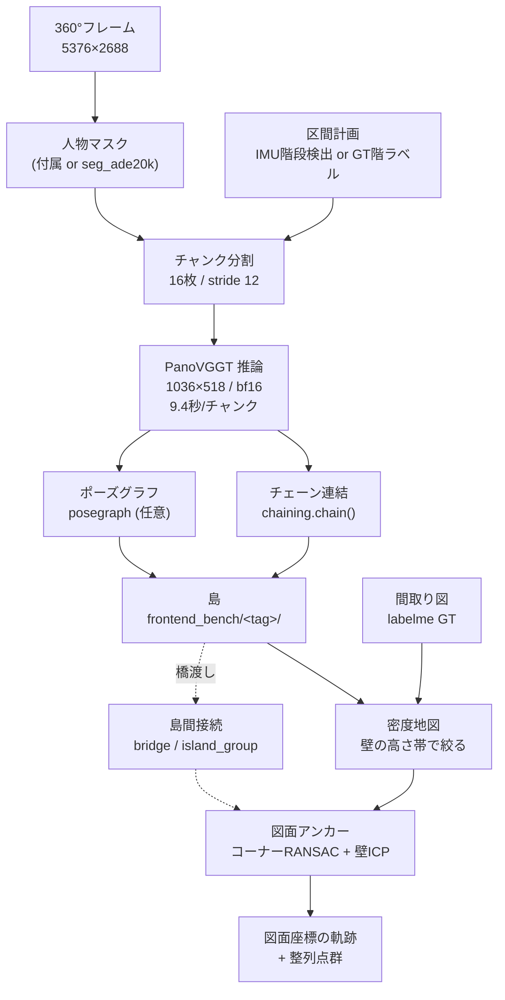
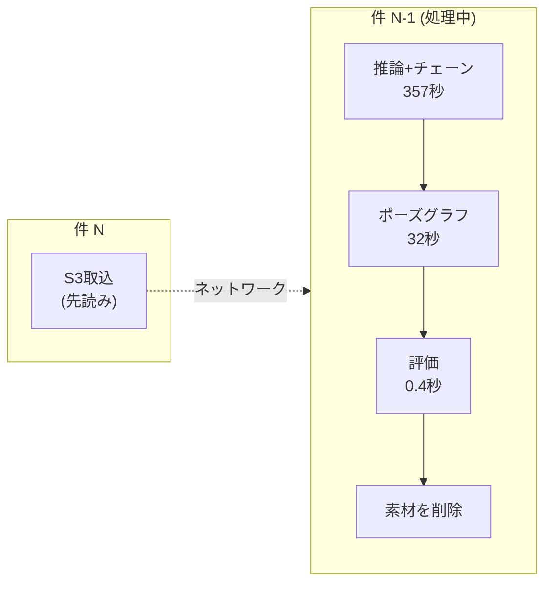

# img_align パイプライン — 構造と使い方

撮影画像(360°動画フレーム)から**カメラ軌跡**と**点群**を作り、**間取り図に
重ねる**までの一連。2026-10-16時点の実装を、実行順に沿って説明する。

実測の根拠は `results/REPORT.md`、残課題は `TODO.md`、モジュール対応表と
「試して捨てた実装」は `README.md` にある。ここは**全体像と動かし方**に絞る。

---

## 1. 全体の流れ



### 用語

| 語 | 意味 |
|---|---|
| **チャンク** | PanoVGGTに1回で渡す連続16フレーム。これ単体の精度は非常に高い (ATE 0.009m) |
| **島** | 1フロアの連続した訪問区間。階段・静止で切る。チャンクを連結して作る |
| **切れ目** | 島と島の境目。階段・静止・`--max-seg` 分割の3種 |
| **群れ** | 橋渡しで繋がった島の集合 |
| **アンカー** | 島を間取り図の座標へ置くこと |

---

## 2. 4段構成

`pipeline.py` が全体を統括する。`run` サブコマンド1本で1〜3段が通る。

### 段1: prep — 入力の準備
フレーム抽出・人物マスク生成。マスクが同梱されていればそれを使う
(`Property.person_mask_dir`)。無ければ `seg_ade20k` で作る。

### 段2: chunks — PanoVGGT推論
`core/chunking.chunk_windows()` が16枚/stride12の窓を切り、
`core/panovggt.run_chunks()` が**まとめて1プロセスで**推論する。

> **バッチ推論は既定で有効**。1チャンクずつ起動するとプロセス起動+モデル
> 読み込みに12.2秒かかり、実推論9秒に対して固定費が55%を占めていた。
> `panovggt_batch` が `load_model` を差し替えて1回に抑える。
> **チャンク1本の計算内容は従来と完全に同一**で、精度には影響しない。

### 段3: chains — 島の生成
区間計画 → 各区間を覆うチャンクを選ぶ → `chaining.chain_and_save()` で連結。

区間計画は2通り。

| `--segments` | 中身 | 用途 |
|---|---|---|
| `imu` | stairnet の階段検出 + ZUPT静止検出 | **本番**(GT不要) |
| `gt` | GTの階ラベル | 開発・評価、IMUが無いデータ |

階の割当は `core/floor_assign.py`。**`ranges` 形式**(`[[a,b,"1F"],…]`)で
書くこと。`islands` 形式(タグ名→階)は島が改名されると外れる。

### 段4: eval / post — 評価と後処理
`--post` で後段を選ぶ。入力はすべて `frontend_bench/<タグ>/`。

| `--post` | 役割 |
|---|---|
| `mapany` | MapAnything条件付け(メートルスケールと点群品質) |
| `bridge` | 島を橋渡しで群れにまとめる(**既定には入れていない**) |
| `anchor` | 図面アンカー(本命) |
| `hier` | 親島からサブ島へ移送(保険。実質未使用) |
| `export` / `viewer` | 整列点群とWebGLビューア |

---

## 3. 動かし方

### 本番(GTなし・IMUあり)

```bash
# 前半: 推論とチェーン。この裏で人が階を割り当てる
IMG_SESSION=0912 python -m img_align.pipeline run --session 0912 \
    --segments imu --max-seg 160 --no-eval

# 階割当の雛形を作って backend/floor_assign.json を編集
IMG_SESSION=0912 python -m img_align.core.floor_assign --template

# 後半: アンカーから出力まで
IMG_SESSION=0912 python -m img_align.pipeline run --session 0912 \
    --segments imu --max-seg 160 --post anchor,export,viewer --no-eval
```

6.3分の動画でゼロから**11分45秒**(RTX4090 Laptop)。前半が動画1分あたり
1.25分、後半が0.3分。階割当は前半の裏で終わるので待ち時間にならない。

### ポーズグラフ(島の精度を上げる)

```bash
IMG_SESSION=0912 python -m img_align.core.posegraph \
    --from-tag pv0912_s001 --tag pg12_pv0912_s001
```

34島の実測で**形状残差 0.0059 → 0.0046 (−22%)**。逐次連結は誤差を一方向に
積むが、全チャンクを同時に解くと解消する。**まだ本番経路には入れていない**
(TODO 0-1b)。

### 外部テストデータの大量実走

```bash
python -m img_align.tools.ext_batch list --limit 20   # 候補を見る
python -m img_align.tools.ext_batch run  --limit 10   # 実走
python -m img_align.tools.ext_batch report            # 集計
```

`polish-pipeline/scripts/sfm_testdataset` の240件(INSTA 156件)を
取り込み→推論→チェーン→ポーズグラフ→評価まで通す。

---

## 4. 大量実走の設計



### ディスクが律速 → 1件ずつ片付ける
1件あたり画像0.4GB + チャンク13GB。156件を残したら2TBになる。
必要なのは**結果JSON(数十KB)とチェーン(13KB/島)だけ**なので、評価が済んだら
`images/` `masks/` `pcd/` を消す。ピークは常に1件分。

### 計算時間の内訳(実測 388枚5フロア = 471秒)

| 工程 | 秒 | 割合 | 最適化 |
|---|---|---|---|
| **推論+チェーン** | **357** | **76%** | バッチ推論済み(22→9.4秒/チャンク) |
| **取込 (S3)** | **82** | **17%** | **先読みで0秒に**(GPUと別資源) |
| ポーズグラフ | 32 | 7% | — |
| 評価 | 0.4 | 0% | — |

**先読み後は1件 約6.5分**。156件で約17時間。

> **実測してから最適化すること。** 当初「subprocessの起動が重い」と見込んだが
> 実測は**0.28秒**で無視できた。的を外すところだった。

### 再開可能
`<dir>/result.json` があればskip。中断しても続きから走る。

---

## 5. パッケージ構成

```
img_align/
  pipeline.py        統括 (run サブコマンド)
  config.py          物件レジストリ。ext/ は meta.json から自動登録
  core/              前段: 入力→島
    chunking.py        区間計画・チャンク窓・一括推論の呼び出し
    panovggt.py        PanoVGGT実行 (run_chunks)
    panovggt_batch.py  モデル読み込みを1回にするバッチ実行
    chaining.py        チャンク連結 (chain / chain_and_save)
    posegraph.py       ポーズグラフ+ループ拘束
    bridge.py          橋渡しチャンク (島間接続の素)
    island_group.py    橋で島を群れにまとめ、結合チェーンを書く
    floor_assign.py    階の手動割当 (ranges形式)
    plan_grid.py       図面のグリッド表現
  postproc/          後段: 島→図面座標
    anchor.py          prepare_island (密度地図づくり) / anchor_island
    corners.py         コーナーRANSAC + 壁ICP (アンカーの本体)
    anchor_score.py    候補の採点 (f1 × cam_feas^2 × スケール罰)
    density_band.py    壁の高さ帯を実測する
    scale_prior.py     島のメートル尺度 (mapany / slab / 較正)
    plan_icp.py        図面の壁線分・座標変換
  eval/              評価 (GTが要るもの。本番では使わない)
    gt_traj.py         GT読み込み
    anchor_confidence.py  島ごとのGT残差と指標
    anchor_oracle.py   候補に正解が入っているか (提案 vs 検証の切り分け)
    anchor_blame.py    どのスコア項が偽解に負けているか
    bridge_eval.py     橋渡しの評価
    outdoor_label.py   屋外島の判定 (outdoor_classification を集計)
    island_diag.py     島内誤差の分解 (累積/局所破綻/歪み)
    island_viewer.py   島の点群をWebGLで見る
  out/               レポート生成
    viewer.py          整列点群のビューア
    all_report.py      全データセット横断レポート
    ext_report.py      外部データのレポート
    pg_report.py       ポーズグラフ比較レポート
  tools/
    ext_batch.py       外部データの大量実走
    align_tool.py      軌跡を手で図面に登録する
```

---

## 6. 現在の到達点

| 指標 | 値 |
|---|---|
| 島の形状品質 (34島、図面幅で正規化) | 逐次 **0.0059** / PG+ループ **0.0046** |
| 図面アンカー成功 (≤1m、屋外除く21島) | **13/21 = 62%** |
| 所要時間 (6.3分の動画) | **11分45秒** |

**アンカーが律速**。チェーンの質は初見の物件でも成立する(外部データで実証)
一方、アンカーは物件によって0/2〜5/5と大きく振れる。しかも**チェーンの質と
アンカーの成否は直結しない**(0925は形状最良クラスでアンカー3/10、0912は
形状最悪クラスでアンカー5/5)。

---

## 7. 落とし穴 (実際に踏んだもの)

| 事項 | 内容 |
|---|---|
| **per_frame を消すな** | `panovggt_out/pointclouds/per_frame/` は `chain()` のチャンク間ICPが使う中核。消すとチャンクが**再生成できなくなる** |
| **掌性** | PanoVGGTのworld系は図面と**鏡像**。`density_map` は z 反転で吸収するが、チェーンの生の姿勢は未補正 |
| **ビューアはZ上向き** | `viewer_template.html` は `up=(0,0,1)`。整列系は y+ が物理下向きなので `(x, z, -y)` で渡す |
| **floor_assign は ranges 形式** | `islands` 形式は島が改名されると外れる |
| **`--stride`/`--chunk-size`** | チャンク置き場・マニフェスト・**タグ**をすべて分ける。タグを分けないとチェーン出力を上書きする |
| **一致度は島ゲージ単位** | `m_per_unit` で正規化しないと物件をまたいだ瞬間に意味が変わる (0.45〜1.60 と3倍違う) |
| **レポートに生成条件を書く** | 設定を変えながら検証するので、無いとどの条件の数字か分からなくなる |
