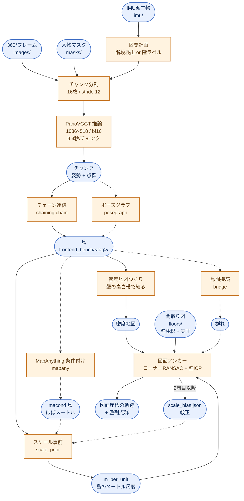
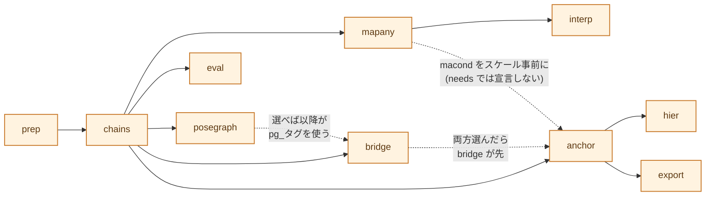

# recon3d パイプライン — 構造と使い方

360°動画フレームから**カメラ軌跡**と**点群**を作り、**間取り図に重ねる**まで。

| 知りたいこと | 行き先 |
|---|---|
| とにかく動かしたい | [1. まず動かす](#1-まず動かす) |
| 何がどう繋がっているか | [2. 全体像](#2-全体像) |
| 各ステップが何をするか | [3. ステップリファレンス](#3-ステップリファレンス) |
| やりたいことの手順 | [4. レシピ](#4-レシピ) |
| 設定キーの意味 | [5. 設定パラメータ](#5-設定パラメータ) |
| Docker / k8s で回す | [6. 実行環境](#6-実行環境) |
| どのファイルに何があるか | [7. パッケージ構成とテスト](#7-パッケージ構成とテスト) |
| いま何割当たるのか | [8. 現在の到達点](#8-現在の到達点) |
| ハマりどころ | [9. 落とし穴](#9-落とし穴-実際に踏んだもの) |

実測の根拠は `results/REPORT.md`、残課題は `TODO.md`、モジュール対応表と
「試して捨てた実装」は `README.md`。

---

## 1. まず動かす

### 入力はディレクトリ1つ

外部パイプラインが用意した**1つのディレクトリがデータセットそのもの**。
リポジトリを編集せずに新しい物件を回せる。

```
reconstruction/            ← このパスを input= に渡す
  images/   frame_number_000000.jpg ...   必須。360°等距円筒 5376×2688
  masks/    frame_number_000000.jpg ...   人物マスク (白=有効/黒=人物)
  imu/      transitions.json  idle_spans.json   IMU派生物 (外部生成ずみ)
  floors/   1F.json 1F.jpg 2F.json 2F.jpg  meta.json
  results/                                ← 出力はここだけ。入力は不変
```

`floors/meta.json` に**図面の実寸**を書く。これが無いと図面アンカーは動かない。

```json
{"known_width_mm": {"1F": 13877.5, "2F": 13877.5, "3F": 11375.0}}
```

> **壁注釈 (labelme) だけでは足りない。** px→m を決める `known_width_mm`
> (最外壁芯間のx方向スパン[mm]) が要る
> (`core/plan_grid.PlanGrid` → `plan2model.calibrate.scale_mm_per_px`)。
> 階でスパンが違う物件 (セットバック等) は階名→mm の辞書、同じなら数値1つ。

### 3コマンド

```bash
# ① 点検 — 何が走って何が落ちるかを先に見る (実行はしない)
python main.py inspect input=/data/reconstruction

# ② 推論とチェーン (GPU。イメージの中で走らせる)
docker compose exec recon3d python main.py run \
    input=/data/reconstruction 'steps=[chains]'

#    この裏で人が階を割り当てる → results/backend/floor_assign.json
python main.py tool floor_assign --input /data/reconstruction --template

# ③ アンカーから書き出しまで (既存チャンクを使うので GPU 不要)
python main.py run input=/data/reconstruction 'steps=[anchor,export]'
```

6.3分の動画でゼロから**11分45秒** (RTX4090 Laptop)。前半が動画1分あたり
1.25分、後半が0.3分。階割当は前半の裏で終わるので待ち時間にならない。

### 出力

```
reconstruction/results/
  pcd/              チャンク (姿勢 + 点群)。**消すと再生成できない**
  frontend_bench/   島ごとのチェーン (global_cameras.npz / global_points.ply)
  backend/          アンカーjson / 整列点群 / ビューア
  imu/              入力の imu/ を取り込んだもの + 派生物
```

島タグの接頭辞は**入力ディレクトリ名**から付く (`recon_0912` →
`pvrecon_0912_s001`)。同じ入力を条件違いで回すなら、入力ディレクトリごと
別名にする — データセット名は**ディレクトリ名が唯一の出所**。

### 詰まったら inspect

```
$ python main.py inspect input=/data/reconstruction
dataset reconstruction  root /data/reconstruction
frames  757枚  (0..756)
  [x] frames        360°等距円筒フレーム (images/frame_number_*.jpg)
  [x] masks         人物マスク (masks/frame_number_*.jpg、白=有効)
  [x] imu_segments  IMU区間 (imu/transitions.json)
  [ ] scale         図面の実寸 (floors/meta.json の known_width_mm)
        -> 図面の実寸が未設定。floors/meta.json に {"known_width_mm": 13877.5} を書く
  ...
実行できるステップ: prep -> chains
skip anchor: 図面の実寸が未設定 ...
```

`core/caps.py` が入力を見て能力を判定し、`steps.py` が振り分ける。

- **明示的に選んだステップ**が能力不足 → **エラーで止める**
- **前提として自動で補われたステップ**が能力不足 → 理由を出して skip

| 能力 | 条件 | 欠けたとき |
|---|---|---|
| `frames` | `images/frame_number_*.jpg` | 全ステップが不可 |
| `masks` | `masks/` に実ファイル | 警告のみ (マスク無しで続行) |
| `imu_segments` | `imu/transitions.json` | `segments=imu` が不可 |
| `imu_idle` | `imu/idle_spans.json` | 静止での島切断をしない |
| `floors` | `floors/*.json` に `label=wall` | アンカー不可 |
| `scale` | `known_width_mm` or `mm_per_px` | アンカー不可・評価不可 |
| `scale_prior` | `backend/scale_bias.json` または `macond*` | **止めない**。`slab` 事前 (誤差97〜383%) に落ちて当たりにくくなる |
| `gt` | `trajectory_points.csv` | 評価ステップを skip |
| `floor_assign` | `backend/floor_assign.json` | 階未割当の島はアンカーを skip |

> **黙って縮退しないのが設計方針。** かつて `IMG_SESSION` 未設定が既定
> セッションに落ち、**別物件の図面とGTで例外なしに完走した**事故があった
> (2026-10-09)。いまは所在が `Paths` で引数として配られ、渡し忘れは
> `TypeError` で即座に出る。

---

## 2. 全体像

記号の約束: **角丸 = データ** / **四角 = 処理**。点線は**既定では通らない経路**
(ポーズグラフ・MapAnything・橋渡しは `steps` に入れたときだけ)。



**図面アンカーが食うのは3つ** — 密度地図・間取り図・`m_per_unit`。
3つ目を見落としやすい ([ステップ anchor](#anchor--図面アンカー-本命) 参照)。

### 用語

| 語 | 意味 |
|---|---|
| **チャンク** | PanoVGGTに1回で渡す連続16フレーム。これ単体の精度は非常に高い (ATE 0.009m) |
| **島** | 1フロアの連続した訪問区間。階段・静止で切る。チャンクを連結して作る |
| **切れ目** | 島と島の境目。階段・静止・`chunking.max_seg` 分割の3種 |
| **群れ** | 橋渡しで繋がった島の集合 |
| **アンカー** | 島を間取り図の座標へ置くこと |
| **ゲージ** | 島の長さの単位。非メートルなので `m_per_unit` を掛けて初めて m になる |

---

## 3. ステップリファレンス

ステップは `recon3d/steps.py` の登録表で定義する。各ステップが `needs` を宣言し、
`graphlib` が順序を決める。**選んだステップの前提は自動で補われる**
(`steps=[anchor]` → `prep → chains → anchor`)。



> **書いた順ではなく依存で決まる。** 旧 `--post a,b,c` は書いた順に実行して
> いたので、`--post anchor,bridge` と書くと群れ化の**前に** anchor が走り、
> 指定した意味が出なかった。いまは `'steps=[anchor,bridge]'` でも bridge が先。

`python main.py steps` で一覧と依存が出る。

### `prep` — 入力の取り込み

入力の `imu/*.json` `imu/*.npz` を `results/imu/` へ**コピー**する
(`core/ingest.materialize_imu`)。取り込んだ名前を `_materialized.json` に
記録し、次回はそれを消してから張り直す。

> **なぜコピーで、なぜ台帳が要るか。** `core/chunking.imu_segments` は
> `exists()` しか見ないので、古いコピーが残ると入力を差し替えても永久に
> 古い区間が使われる。symlink にしない理由は、`results/imu/` が読み書き共用で
> 11モジュール14種類のファイルがここへ書くから (`imu_raw_traj.npz` は数十MB)
> — ディレクトリ symlink は入力を汚染し、ファイル symlink は docker
> (`/code2` マウント) から dangling する。

人物マスクは**入力に同梱されている前提** (`masks/`)。無ければ警告のみで
マスク無しで続行する (生成モジュール `seg_ade20k` は 2026-10-19 に撤去)。

`steps` に `mapany` が入っていれば、ここでピンホールクロップも作る。

### `chains` — チャンク推論 + 島の生成

`core/chunking.chunk_windows()` が16枚/stride12の窓を切り、
`core/panovggt.run_chunks()` が**まとめて1プロセスで**推論する。
そのあと区間計画 → 各区間を覆うチャンクを選ぶ → `chaining.chain_and_save()`。

**既存のチャンクはスキップされる**ので、条件を変えた再実行は安い。

区間の切り方は2通り (`segments`)。

| 値 | 中身 | 用途 |
|---|---|---|
| `imu` | 階段検出 + ZUPT静止検出 (`imu/transitions.json`) | **本番** (GT不要) |
| `gt` | GTの階ラベル | 開発・評価、IMUが無いデータ |

階の割当は `core/floor_assign.py`。**`ranges` 形式** (`[[a,b,"1F"],…]`) で
書くこと — `islands` 形式 (タグ名→階) は島が改名されると外れる。

> **バッチ推論は既定で有効。** 1チャンクずつ起動するとプロセス起動+モデル
> 読み込みに12.2秒かかり、実推論9秒に対して固定費が55%を占めていた。
> `panovggt_batch` が `load_model` を差し替えて1回に抑える。
> **チャンク1本の計算内容は従来と完全に同一**で、精度には影響しない。

主なパラメータ → [`chunking`](#chunking--推論とチェーンの作り方)

### `posegraph` — 島を解き直す (任意)

逐次連結は誤差を一本道に積む。全チャンクを5自由度 (log scale / ヨー / 並進)
で同時に解き、再訪ループ拘束を足す。出力は `frontend_bench/pg_<島タグ>/` で、
**以降のステップはこちらを対象にする** (`pg_manifest.json` に差し替わる)。

> **逐次エッジだけのポーズグラフは逐次連結と同じ解になる。** 木構造で
> 冗長性がゼロだから。採用ループ0本の島は `rms` がちょうど 0 になり、
> 「何も変わらない」のは異常ではない。改善は再訪ループが入って初めて生じる
> (34島の実測で形状残差 0.0059 → 0.0046、**−22%**)。

主なパラメータ → [`posegraph`](#posegraph--島をポーズグラフで解き直す)

### `mapany` / `interp` — MapAnything 条件付け (任意)

ピンホールクロップに既知内参と pv ポーズを条件付けして MapAnything へ通し、
**ほぼ実寸 (メートル)** の島 `macond*` を得る。`interp` はその制御点と
pv チェーンの局所形状から全フレームを補間する (`maf*`)。

軌跡そのものの改善は小幅 (median −7〜15%) だが、**メートルスケールの供給源**
としてアンカーに効く (次項)。16GB VRAM で約55ビューが上限なので stride 間引き。

### `bridge` — 島を群れにまとめる (任意)

切れ目の両側のフレームを1チャンクに混ぜて PanoVGGT に1度通し、島間の
相対 Sim(3) を得る。逐次縫合を介さないので階段での破綻を避けられる。

> **橋の残差で採否を決めてはいけない。** 残差0.003で0.16m、残差0.128で4.30m
> という実測がある — 「両側のチェーンには合うが相対関係は誤り」を残差は
> 検出できない。だから**方式間の一致度**で判定する。
> ただし **`thresh` はホールドアウトで破綻した** (2026-10-16)。21切れ目で
> 決めた値で、外部データ2件では運搬誤差の中央値が島単独の9倍になった。
> 新しい物件では**値を信用せず、まず一致度の分布を見る**こと。

主なパラメータ → [`bridge`](#bridge--島を群れにまとめる)

### `anchor` — 図面アンカー (本命)

密度地図から L/T コーナーを検出し、図面コーナーと RANSAC 照合してから壁 ICP。
島は互いに独立なのでプロセス並列する。

**食う入力は3つ** — (1) 密度地図 (2) 間取り図 (3) `m_per_unit`。

3つ目を見落としやすい。`match_corners` は事前スケールの **±40% しか探索しない**
ので、`m_per_unit` がずれていると**正解の仮説がそもそも生成されない**。
供給源は3つで、精度が桁違い:

| 供給源 | 誤差 (0912実測) | 中身 | いつ使うか |
|---|---|---|---|
| `calib` | 1%以内 | `backend/scale_bias.json` | **最優先**。あれば使う |
| `mapany` | **5〜25%** | macond 島のカメラ軌跡との相似フィット | macond タグがあれば |
| `slab` | **97〜383%** | カメラ高 / 床スラブピーク | 上2つが無いときの最後の砦 |

> **MapAnything の点群は使っていない。** 使うのは**スケール係数1つだけ**
> (島のカメラ軌跡と macond 軌跡の相似フィット)。点群の床検出に依存しないので
> `slab` より桁違いに安定する。

> **`mapany` → `anchor` は `needs` で宣言していない。** macond が無ければ
> `slab` 事前に落ちて**動いてしまう**し、必須にすると図面だけある物件
> (MapAnything を回せない / 回したくない) でアンカーが止まる。
> 代わりに `main.py inspect` の `scale_prior` 行で、どの事前に落ちるかを
> 必ず見えるようにしてある。較正の手順は
> [2周目の較正](#2周目の較正-mapany-を外す)。

### `hier` — 親島から移送 (保険)

直接アンカーに失敗した**分割サブ島**へ、親島のアンカーから相似変換を移送し
壁 ICP だけで仕上げる (RANSAC 不使用 = 偽解の余地なし)。

親島は `segments=gt` の階区間分割でしか作られない。`max_seg` の長島分割は
親 island を残さないので、本番経路 (`segments=imu`) では**対象ゼロが正常**。

### `export` — 書き出し

アンカー変換 (重力整列 → z反転 → セル → 相似 → 図面px → メートル) で島点群を
図面座標へ。鉛直スケールはアンカーの水平スケールから導出し、高さ基準は
物理床ピーク。`export.viewer=true` なら確認PNG + WebGLビューアも出す。

### `eval` — GT軌跡との比較

重力整列 → XZ平面 → 鏡映2択 × 2D相似フィットで GT 軌跡へ合わせ、残差を測る
(**フィットATE**)。図面照合を使わないので「前段の相対幾何の正確さ」だけを
公平に測れる。**GT と図面実寸の両方**が要るので、無い入力では skip される。

---

## 4. レシピ

### 図面が無いとき (軌跡と点群だけ作る)

壁注釈や実寸が無くても**軌跡生成とポーズグラフは動く**。ステップを絞って回す。

```bash
python main.py inspect input=/data/reconstruction
python main.py run input=/data/reconstruction 'steps=[posegraph]' segments=imu
```

`prep → chains → posegraph` が走る。GT も無いので測れるのは内部指標だけ:

| 見るもの | 置き場 |
|---|---|
| 逐次連結のチャンク間ICP残差・スケール | `frontend_bench/<島>/chain_log.json` |
| PG の rms・採用ループ数・スケール幅 | `frontend_bench/pg_<島>/chain_log.json` |
| 点群の形 (目視) | `python main.py tool island_viewer --input /data/x --islands <タグ>` |

> この「ループ0本なら rms=0」という不変条件は 2026-10-20 まで**静かに破れて
> いた**。スケールの暴走よけ `LOG_S_BOUND` が `|log s_k| <= 0.35` という
> **絶対値の箱**だったため、累積スケールがドリフトした島では初期解が実行可能
> 領域の外に落ち、`np.clip` で押し込まれたまま戻れなくなる。21島中6島で発生し、
> 0912_s011 では rms 0 → 0.0403 / ATE 0.215 → 0.276m、0715_s00 では
> **最適化が出発点より悪い解を返して**いた (0.0436 → 0.0779)。
> いまは箱を**初期解のまわりに中心化**してあるので x0 は常に内点。
> 累積スケールが ×1.42 を超える島には拘束ではなく**警告**を出す
> (当たった島の逐次ATE中央値 0.23m に対し、当たらない島は 0.05m)。

### 2周目の較正 (mapany を外す)

アンカー後の相似スケール `s` は事前の誤りをそのまま表すので、
**補正後 = 事前 × s** が実測1%以内で成立する。GT 無しで較正できる。

```bash
# 1周目: macond を作ってアンカー (mapany 事前)
python main.py run input=/data/x 'steps=[mapany,anchor]'

# 較正ファイル backend/scale_bias.json を書く
python main.py tool scale_prior --input /data/x --calibrate
#   → [scale_prior] 較正: bias=1.079 MAD=0.042 (系統バイアス, n=4)

# 2周目以降: MapAnything 無しでも良い事前が使える
python main.py run input=/data/x 'steps=[anchor,export]'
```

MAD が小さければ「物件全体の系統バイアス」、大きければ「島ごとのばらつき」。

### 同じ入力で条件を変えて比べる

```bash
... run input=/data/x chunking.chunk_size=24
... run input=/data/x chunking.stride=8
... run input=/data/x 'steps=[bridge,anchor]' bridge.skip_cross_floor=true
```

> **`stride` / `chunk_size` を変えると別世界になる。** チャンク置き場
> (`chunks_s8` / `_c24`)・マニフェスト・**タグ**がすべて分かれる。
> チャンク番号→フレームの対応が変わるため必須の分離だが、その分
> **ディスクも増える** (1件13GB)。比較実験のあとは消すこと。

結果ごと分けたいなら**入力ディレクトリを別名にする** (データセット名は
ディレクトリ名が唯一の出所)。

### 個別モジュールを叩く (`tool`)

ステップより細かい単位で回したいとき。各モジュールの argparse をそのまま使い、
`-h` はツール側のヘルプへ通る。49本ある。

```bash
python main.py tool                                     # 一覧
python main.py tool posegraph  --input /data/x --from-tag pv_s001
python main.py tool corners    --input /data/x --anchor pv_s001:1F
python main.py tool scale_prior --input /data/x --calibrate
```

### 外部テストデータ (ホールドアウト)

`polish-pipeline/scripts/sfm_testdataset` 由来の 240件 (INSTA 156件) を
`ext/sfmXXXX/` に取り込んである。入力ディレクトリ渡しなので**そのまま
`input=` に渡せる** (専用の一括実走ドライバは 2026-10-19 に撤去した)。

```bash
python main.py inspect input=ext/sfm11196
python main.py run     input=ext/sfm11196 'steps=[chains]'
```

> **図面の壁アノテーションが無い**ので図面アンカーは評価できない。
> GT軌跡だけで測れるもの (島の形状品質・橋渡し・カバレッジ) に限られる。
> **ディスクが律速**: 1件あたり画像0.4GB + チャンク13GB。評価が済んだら
> `results/pcd/` と `images/` を消すこと。

### 図面 → 3Dモデル (撮影データ不要)

撮影と独立の系統。`floors/` だけで走る。

```bash
python main.py plan2model build  input=/data/x
python main.py plan2model verify input=/data/x     # 2D再投影IoU
```

---

## 5. 設定パラメータ

`recon3d/conf/recon.yaml` が実行時の全パラメータ。`key=value` で上書きする。
**`null` は「コードの既定値を使う」**という意味で、0 や false とは違う。

### トップレベル

| キー | 既定 | 説明 |
|---|---|---|
| `input` | なし(必須) | 入力ディレクトリ。`images/ masks/ imu/ floors/` が並ぶ親 |
| `steps` | `[prep, chains, anchor, export]` | 走らせるステップ。**前提は自動で補われる**ので終点だけ書けばよい (`[anchor]` → prep,chains,anchor) |
| `segments` | `imu` | 島の切り方。`imu`=階段検出+静止検出 (**本番**、GT不要) / `gt`=GT軌跡の階ラベル |

> `segments` はステップではなくオプションなので、能力検査は `chains` の中で行う。
> `imu` を指定して `imu/transitions.json` が無ければ**止まる** — 黙って `gt` へ
> 落とすと、GTの無い物件で別物件のGTを読む経路に入る。

### `chunking` — 推論とチェーンの作り方

| キー | 既定 | 説明 |
|---|---|---|
| `max_seg` | `160` | 島の最大フレーム数。超える区間は等分割。`0` で分割しない。**島は短いほどドリフトが小さい** (≤130フレームで median 0.03〜0.27m) が、短すぎるとアンカーの手がかりが足りない (36フレーム未満の島は捨てる) |
| `stride` | `null`→`12` | チャンク窓の送り幅。重なり = `chunk_size - stride` = 4フレーム。**小さくしても精度は上がらない** (下記) |
| `chunk_size` | `null`→`16` | 1チャンクのフレーム数。大きくすると接続本数が減り、累積スケール誤差が効きにくくなる |
| `model` | `pv` | 前段モデル。`pv`=PanoVGGT / `pi3` / `holo`=Pi3-Finetuned-Holo360D (後2つは pi3 コンテナ)。チャンク置き場・タグ・マニフェストがモデル別に分かれるので共存できる |
| `manifest_out` | `null`→`<model>_manifest.json` | 島台帳のファイル名。`bridge` と `posegraph` も同じ名前を読む |
| `use_idle` | `true` | 静止区間 (ZUPT) で島を切る。`false` は対照実験用 |
| `yaw_fix` | `false` | チャンク内フレーム回転を修復してから**チェーンし直す**。方位ロック撮影でのみ有効 |
| `crops` | `false` | `mapany` 用のピンホールクロップ (FOV130°/pitch10°/518px) を `prep` で作る。**`steps` に `mapany` があれば自動**なので、明示指定は「推論はまだ回さないがクロップだけ先に用意したい」とき |

> **`stride` を下げても島は良くならない** (2026-10-16、外部データ10島)。
> 12→10 で接続1本あたりの `|log s|` は 0.195→0.154 (−21%) と良くなるが、
> チャンクが27%増えて掛け合わせる回数も増え、島の形状残差は
> 0.0060→0.0071 (**+19%**) と悪化した。スケール誤差は乗算で累積するので、
> 1本あたりを良くしても本数が増えれば相殺される。効かせたいなら
> **`chunk_size` を上げて本数を減らす**方向。

### `posegraph` — 島をポーズグラフで解き直す

| キー | 既定 | 説明 |
|---|---|---|
| `prefix` | `pg_` | 出力タグの接頭辞。`frontend_bench/pg_<島タグ>/` に書く |
| `yaw_w` | `null`→`20.0` | 逐次エッジのヨー残差の重み (rad→m 相当への換算) |
| `loops` | `true` | 再訪ループ拘束を入れる。**`false` だと逐次連結と完全に同じ解になる** |

> ループ候補は「チャンク番号が3以上離れ、重心距離が2.0 (カメラ高=1の相対単位)
> 以内」で、ICP残差 0.12 以下なら採用する (`core/posegraph.py` の定数)。

> **`LOG_S_BOUND` (0.35) は「初期解からのずれ」の上限**であって、累積
> スケールの絶対値の上限ではない。絶対値で縛ると、累積スケールが素直に
> ドリフトした島 (21島中6島) で初期解が実行可能領域の外に落ちる
> (2026-10-20 に修正。経緯は [図面が無いとき](#図面が無いとき-軌跡と点群だけ作る))。
> 累積スケールが ×1.42 を超えると `[warn]` を出すが、これは拘束ではない
> — 直したければ再訪ループが要る。

### `bridge` — 島を群れにまとめる

| キー | 既定 | 説明 |
|---|---|---|
| `modes` | `null`→`[n8s1, n8s2, n8s4]` | 橋の方式。`nNsM` = 切れ目の**両側から N フレームずつ、M フレームおきに**取って1チャンクで推論。**先頭が実際に採用する変換**、残りは一致度を測る対照 |
| `thresh` | `null`→`1.2` | 方式間の一致度[m]がこれ未満の切れ目だけ繋ぐ |
| `skip_cross_floor` | `false` | 階をまたぐ切れ目は橋を試さない。推論を約37%節約 |

### `anchor` / `export`

| キー | 既定 | 説明 |
|---|---|---|
| `anchor.jobs` | `null`→`CPU数/4` | アンカーの並列数。島ごとに完全独立なのでプロセス並列できる。`1` と `4` で結果が一致することは検査ずみ |
| `export.viewer` | `true` | 真上ビュー確認PNG + 単体WebGLビューアも出す |

### `floors/meta.json` — 入力側に置く図面のパラメータ

| キー | 必須 | 説明 |
|---|---|---|
| `known_width_mm` | **アンカーに必須** | 図面の実寸 = **最外壁芯間のx方向スパン[mm]**。これで px→m が決まる。階でスパンが違う物件は `{"1F": 13877.5, "3F": 11375.0}` の辞書、同じなら数値1つ |
| `mm_per_px` | 任意 | 実測スケールが分かっているとき直接指定。あれば `known_width_mm` からの導出より優先 |
| `drawing_wh` | 任意 | 図面画像サイズ `[幅, 高さ]`。既定 `[2480, 1753]` (A4横300dpi) |

> ここに書いた値は**入口で型検査される**。`known_width_mm` に文字列が入ると
> `scale_mm_per_px` が `TypeError` を出し、その例外は図面を読む瞬間に飛ぶので
> 原因が分かりにくい。`ext/` の meta.json にある `s3key` / `n_frames` などの
> 覚え書きキーは素通りする。

---

## 6. 実行環境

### 単一イメージ (`reconstruction3d_experimental/Dockerfile`)

**PanoVGGT 推論から図面アンカー・書き出しまで、ぜんぶ同じプロセスで走る。**
以前は PanoVGGT だけ専用 conda env の subprocess だったが、Docker 外で
実行しない方針になったので1環境に寄せた (2026-10-19)。

```bash
docker compose build recon3d
# ローカル: マウントした編集中のコードで動く (compose が working_dir を設定ずみ)
docker compose exec recon3d python main.py run input=/data/reconstruction
# 焼いたコードで動かす (k8s と同じ経路を確かめたいとき)
docker compose exec -w /opt/recon3d recon3d python main.py run input=...
```

| 項目 | 中身 |
|---|---|
| base | `pytorch/pytorch:2.5.1-cuda12.4-cudnn9-runtime` (PanoVGGT が torch 2.5 系を要求) |
| PanoVGGT | `/opt/panovggt` に sha 固定で clone (MIT) |
| コード | `recon3d/` と `main.py` を `/opt/recon3d` へ COPY。**焼いたコードが動く** — `python main.py` は sys.path[0] にスクリプトのディレクトリを置くので PYTHONPATH では上書きできない。編集中のコードを使うときは compose の `working_dir: /code2/reconstruction3d_experimental` 側で動かす |
| 重み | **焼かない** (3.9GB)。`PANOVGGT_CKPT` で指す。ローカルは `/home/maren/models`、k8s は PVC / initContainer |
| 入れていないもの | `mesh/*` (open3d) / pi3・holo (別コンテナ) |

> **`PANOVGGT_DIR` が未設定なら推論ステップで止まる。** 開発ホストの python には
> 別バージョンの torch が入っていて `import inference` が**通ってしまう**が、
> PanoVGGT が想定するのは 2.5 系。「動くが結果が違う」を防ぐため、
> イメージだけがこの変数を持つようにしてある。
> 既存チャンクを使うステップ (posegraph / anchor / export / 評価) は GPU も
> PanoVGGT も要らないので、ホストのままで動く。

> **`reconstruction3d_experimental` は 188GB** (28-BBBBB だけで155GB)。
> `.dockerignore` が `recon3d/` と `main.py` だけに絞っている。外すと
> ビルドが終わらない。

> **コンテナが書いたファイルは root 所有**になる。ホストから消せないときは
> `docker compose exec recon3d chown -R 1001:1001 /code2/reconstruction3d_experimental`。

### Kubernetes / Dagster Pipes

**1ポッド = 1データセット**なら、パイプラインは**1プロセスで完結する**。
`api.run()` は子プロセスを立てない。

```python
# ポッドの入口 (Dagster Pipes)
from dagster_pipes import open_dagster_pipes

with open_dagster_pipes() as pipes:
    from recon3d import api
    res = api.run(pipes.get_extra("input"),
                  steps=pipes.get_extra("steps"), segments="imu")
    pipes.report_asset_materialization(
        metadata={"results": res.results_dir, "islands": len(res.islands)})
```

import の順序に規則は無い。`api.run()` に入力ディレクトリを渡した時点で
`Paths` が決まり、そこから先は全部引数で流れる。CLI をそのままポッドの
コマンドにしてもよい (`exec` して PID 1 にできる)。

同一プロセスで別のデータセットを回したければ `Paths` を作り直すだけでよい
— 所在はインスタンスで引数として配られるので干渉しない。

#### SIGTERM は PID 1 にしか来ない

k8s はポッド終了時 PID 1 にだけ SIGTERM を送る。放っておくと入口だけ死んで
**子孫が孤児化して走り続ける** — 実測で、GPU推論の subprocess とアンカーの
`ProcessPoolExecutor` ワーカーが全部生き残った。GPU を掴んだまま
`terminationGracePeriod` の SIGKILL を待つので、Dagster 側のキャンセルは
成功したように見える。

`core/signals.forward_to_process_group()` を CLI の入口で1回呼び、シグナルを
**プロセスグループ全体**へ中継している (グループリーダーのときだけ)。
`api.run()` をライブラリとして直接呼ぶ入口を自分で書くなら、**そこでも同じ
ことをする**か、ポッドの `command` を CLI にすること。

#### 並列数はポッドの CPU 割当に合わせる

`anchor.jobs` の既定は `core/caps.cpus() // 4`。`cpus()` は
cgroup v2 `cpu.max` → cgroup v1 `cpu.cfs_quota_us` → `sched_getaffinity` →
`os.cpu_count()` の順で解決する。

> **`os.cpu_count()` を直接使ってはいけない。** ノードのコア数を返すので、
> CPU limit 付きのポッドでは桁違いの並列数になる (ノード64コア → 16並列、
> 割当は4コア)。アンカーは島ごとに点群を読むので、そのまま OOMKilled になる。

メモリが律速なら `anchor.jobs` を明示的に下げる。

### データセットを指すのは `input=` だけ

環境変数は**使わない**。所在は `paths.Paths` に入り、各ステップへ**引数で**配られる。

| 要素 | 出所 |
|---|---|
| データセット名 (タグ接頭辞) | 入力ディレクトリ名 |
| 入出力の場所 | `Paths` (入力1ディレクトリから導出) |
| 図面の実寸 | `floors/meta.json` の `known_width_mm` |
| ステップの選択・パラメータ | hydra (`conf/recon.yaml` + `key=value`) |

> `tests/check_imports.py` が「**`paths` に既定値を置かないこと**」を静的に
> 見張っている。既定値を1つ置いた瞬間、渡し忘れが 2026-10-09 の
> 「黙って別物件の図面・GTで完走する」形に戻るため。

---

## 7. パッケージ構成とテスト

```
recon3d/
  steps.py           **ステップの登録表と依存解決** (順序はここが決める)
  api.py             外部から呼ぶ入口 (run / plan)。プロセス内で実行する
  paths.py           データセットの所在 (Paths)。入力1ディレクトリから導く
  constants.py       入力に依らない定数だけ
  conf/recon.yaml    実行設定 (hydra)
  core/              前段: 入力→島
    caps.py            入力から「何ができるか」を判定 + 使える CPU 数
    signals.py         入口が SIGTERM をプロセスグループへ中継する
    ingest.py          入力の imu/ を results へ取り込み (台帳つき)
    chunking.py        区間計画・チャンク窓・一括推論の呼び出し
    panovggt.py        PanoVGGT実行 (run_chunks)
    panovggt_batch.py  モデル読み込みを1回にするバッチ実行
    chaining.py        チャンク連結 (chain / chain_and_save)
    posegraph.py       ポーズグラフ+ループ拘束
    bridge.py          橋渡しチャンク (島間接続の素)
    island_group.py    橋で島を群れにまとめ、結合チェーンを書く
    floor_assign.py    階の手動割当 (ranges形式)
    plan_grid.py       図面のグリッド表現
  postproc/          後段: 島→図面座標
    anchor_run.py      全島をプロセス並列でアンカーする (ステップの実体)
    anchor.py          prepare_island (密度地図づくり) / anchor_island
    corners.py         コーナーRANSAC + 壁ICP (アンカーの本体)
    anchor_score.py    候補の採点 (f1 × cam_feas^2 × スケール罰)
    density_band.py    壁の高さ帯を実測する
    scale_prior.py     島のメートル尺度 (calib / mapany / slab)
    plan_icp.py        図面の壁線分・座標変換
  eval/              評価 (GTが要るもの。本番では使わない)
    gt_traj.py         GT読み込み
    anchor_confidence.py  島ごとのGT残差と指標
    anchor_oracle.py   候補に正解が入っているか (提案 vs 検証の切り分け)
    anchor_blame.py    どのスコア項が偽解に負けているか
    bridge_eval.py     橋渡しの評価
    island_diag.py     島内誤差の分解 (累積/局所破綻/歪み)
    island_viewer.py   島の点群をWebGLで見る
  out/               書き出し (export / viewer)
  imu/               IMU派生物 (transitions / idle / timeline / flowstate_yaw)
  mesh/              メッシュ・衝突モデル (別コンテナの open3d が要る)
  plan2model/        **間取り図→3Dモデル** (撮影と独立の系統)
    loader calibrate geometry mesh build verify
  tools/
    recon.py           CLI 本体 (typer + hydra)。入口はリポジトリ直下 main.py
    _hydra.py          hydra設定読み込みの共通部
  tests/             pytest 無しでも走る素のスクリプト
```

### テスト

ホストに pytest が無くても動くよう、検査の実体は素のスクリプトに置き、
`test_checks.py` が pytest から同じ関数を呼ぶ。import の副作用を素の状態で
観測したいので、**検査は子プロセス**で行う。

```bash
python -m recon3d.tests.check_imports           # import + paths の規約
RECON3D_FIXTURE=/data/recon_0912 \
  python -m recon3d.tests.check_paths           # 実物で Paths を確かめる
RECON3D_FIXTURE=/data/recon_0912 \
  python -m recon3d.tests.check_tools           # 全ツールに -h を通す
```

`check_imports` が見るのは3つ:

| 検査 | 捕まえる退行 |
|---|---|
| 全モジュールの import | 図面やGTを import 時に読んで、アンカー経路ごと落ちる形 |
| `paths` に既定値を置かない | 渡し忘れが「黙って別物を読む」に戻る形 (2026-10-09の事故) |
| 本番入口が `paths` を受ける | どこかに所在を固定し直してしまった形 |

`check_tools` は `main.py tool <name>` の49本に `-h` を通す。import では
出ない「実行して初めて落ちる」3種 — `main(paths, argv)` でない署名 /
`parse_args()` の argv 渡し忘れ / `help` の `%` 取りこぼし — を拾う。

GPU や別コンテナにしか無い依存 (torch / shapely / open3d …) の
`ModuleNotFoundError` は環境差として除外する — 退行ではない。

**回帰の金床は 0912 の5島アンカー12 JSON のバイト一致。** chains 自体も
決定的 (連続2回でバイト一致)。ただし `global_cameras.npz` の**バイト**は
環境が変わると一致しない (zlib 差) ので、比較は中身の配列で行う。

---

## 8. 現在の到達点

| 指標 | 値 |
|---|---|
| 島の形状品質 (34島、図面幅で正規化) | 逐次 **0.0059** / PG+ループ **0.0046** |
| 図面アンカー成功 (≤1m、屋外除く21島) | **13/21 = 62%** |
| 所要時間 (6.3分の動画) | **11分45秒** |

**アンカーが律速。** チェーンの質は初見の物件でも成立する (外部データで実証)
一方、アンカーは物件によって 0/2〜5/5 と大きく振れる。しかも**チェーンの質と
アンカーの成否は直結しない** (0925は形状最良クラスでアンカー3/10、0912は
形状最悪クラスでアンカー5/5)。

---

## 9. 落とし穴 (実際に踏んだもの)

### データを壊す

| 事項 | 内容 |
|---|---|
| **per_frame を消すな** | `panovggt_out/pointclouds/per_frame/` は `chain()` のチャンク間ICPが使う中核。消すとチャンクが**再生成できなくなる** |
| **`stride`/`chunk_size`** | チャンク置き場・マニフェスト・**タグ**をすべて分ける。タグを分けないとチェーン出力を上書きする |
| **IMU は台帳つきでコピー** | `imu_segments` は `exists()` しか見ないので、古いコピーが残ると入力を差し替えても永久に古い区間が使われる |
| **`.dockerignore` が無いとビルドが死ぬ** | `reconstruction3d_experimental` は188GB。build context をコードだけに絞る |

### 黙って間違った結果を出す

| 事項 | 内容 |
|---|---|
| **`paths` に既定値を置かない** | 既定値を1つ置いた瞬間、渡し忘れが「黙って別物を読む」に戻る (`check_imports` が見張る) |
| **アンカーには実寸も要る** | 壁注釈 (labelme) だけでは px→m が決まらない。`floors/meta.json` の `known_width_mm` が無いと `scale_mm_per_px` が `TypeError` |
| **スケール事前の供給源を確認する** | macond も較正も無ければ `slab` (誤差97〜383%) に落ちる。**動くが当たらない**。`inspect` の `scale_prior` 行を見る |
| **掌性** | PanoVGGTのworld系は図面と**鏡像**。`density_map` は z 反転で吸収するが、チェーンの生の姿勢は未補正 |
| **一致度は島ゲージ単位** | `m_per_unit` で正規化しないと物件をまたいだ瞬間に意味が変わる (0.45〜1.60 と3倍違う) |
| **floor_assign は ranges 形式** | `islands` 形式は島が改名されると外れる |
| **import 時に図面を読まない** | `mm_per_px()` は関数。定数にすると、壁注釈の無い入力で `TypeError` が飛んだ瞬間にアンカー経路36モジュールが **import ごと**落ちる |

### 実行環境

| 事項 | 内容 |
|---|---|
| **SIGTERM は PID 1 にしか来ない** | 放置すると GPU推論の subprocess と fork ワーカーが孤児化して走り続ける (実測)。入口で `core/signals.forward_to_process_group()` を呼ぶ |
| **`os.cpu_count()` はノードのコア数** | ポッドの CPU limit を見ないので過剰並列 → OOMKilled。`core/caps.cpus()` を使う |
| **`os.chdir` は同一プロセスに残る** | PanoVGGT は相対パスで重みを引くので chdir が要る。subprocess 時代は無害だったが、戻さないと後続のステップが相対パスを見失う (`panovggt_batch._in_panovggt` が try/finally で戻す) |
| **ビューアはZ上向き** | `viewer_template.html` は `up=(0,0,1)`。整列系は y+ が物理下向きなので `(x, z, -y)` で渡す |

### 評価

| 事項 | 内容 |
|---|---|
| **レポートに生成条件を書く** | 設定を変えながら検証するので、無いとどの条件の数字か分からなくなる |
| **橋の残差で採否を決めない** | 残差0.003で0.16m、残差0.128で4.30m。方式間の一致度で判定する |
| **21島で決めた定数は疑う** | 壁帯0.7m / スケール外れ値1.5倍 / 最小島長36f / 一致度1.2。うち一致度はホールドアウトで明確に破綻した |
