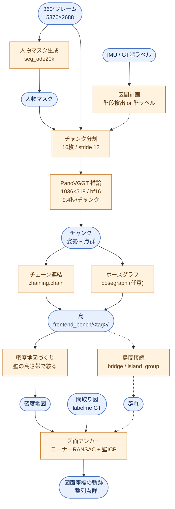
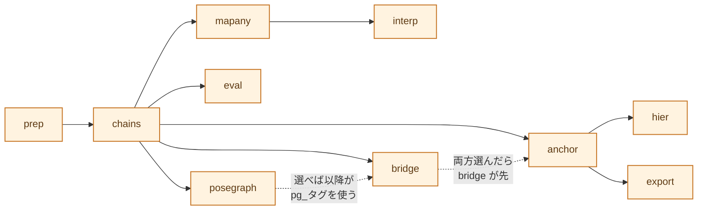

# recon3d パイプライン — 構造と使い方

撮影画像(360°動画フレーム)から**カメラ軌跡**と**点群**を作り、**間取り図に
重ねる**までの一連。2026-10-19時点の実装を、実行順に沿って説明する。

実測の根拠は `results/REPORT.md`、残課題は `TODO.md`、モジュール対応表と
「試して捨てた実装」は `README.md` にある。ここは**全体像と動かし方**に絞る。

---

## 1. 全体の流れ

記号の約束: **角丸 = データ**(入力・中間成果物・出力) / **四角 = 処理**。



点線は**既定では通らない経路** (橋渡しは `steps` に `bridge` を入れたときだけ)。
各段のパラメータは **5章** に一覧がある。

### 用語

| 語 | 意味 |
|---|---|
| **チャンク** | PanoVGGTに1回で渡す連続16フレーム。これ単体の精度は非常に高い (ATE 0.009m) |
| **島** | 1フロアの連続した訪問区間。階段・静止で切る。チャンクを連結して作る |
| **切れ目** | 島と島の境目。階段・静止・`chunking.max_seg` 分割の3種 |
| **群れ** | 橋渡しで繋がった島の集合 |
| **アンカー** | 島を間取り図の座標へ置くこと |

---

## 2. 入力の契約

外部パイプラインが用意した**1つのディレクトリ**がパイプラインの入力になる。
リポジトリを編集せずに新しい物件を回せる。

```
reconstruction/
  images/   frame_number_000000.jpg ...     必須。360°等距円筒
  masks/    frame_number_000000.jpg ...     人物マスク (白=有効/黒=人物)
  imu/      transitions.json  idle_spans.json   IMU派生物 (外部生成済み)
  floors/   1F.json 1F.jpg 2F.json 2F.jpg  meta.json
  results/<session>/                        ← 出力はここだけ。入力は不変
```

`floors/meta.json` に**図面の実寸**を書く。

```json
{"known_width_mm": {"1F": 13877.5, "2F": 13877.5, "3F": 11375.0}}
```

> **壁注釈 (labelme) だけでは図面アンカーは動かない。** px→m を決める
> `known_width_mm` (最外壁芯間のx方向スパン[mm]) が要る
> (`core/plan_grid.PlanGrid` → `recon3d.calibrate.scale_mm_per_px`)。
> 階でスパンが違う物件 (セットバック等) は階名→mm の辞書で書く。
> 単一値なら `{"known_width_mm": 13877.5}` でよい。
> 任意キー: `session` / `gt_session` / `drawing_wh` / `mm_per_px`。

セッション名は既定で**入力ディレクトリ名**。出力は `results/<session>/`。
同じ入力を条件違いで回すなら `session=myrun` で分けられる。

### 入力の欠けに対する態度

**黙って縮退しない。** 既定セッション (28-AAAAA) のGTや図面を読んで
もっともらしい数字を出したまま完走する事故が実際にあった (2026-10-09)。
`core/caps.py` が能力を判定し、`steps.py` が次のように振り分ける。

- **明示的に選んだ段**が能力不足 → エラーで止める
- **前提として自動で補われた段**が能力不足 → 理由を出して skip

```bash
python main.py inspect input=/data/reconstruction
```

| 能力 | 条件 | 欠けたとき |
|---|---|---|
| `frames` | `images/frame_number_*.jpg` | 全段が不可 |
| `masks` | `masks/` に実ファイル | 警告のみ (マスク無しで続行 / seg_ade20k) |
| `imu_segments` | `imu/transitions.json` | `segments=imu` が不可 |
| `floors` | `floors/*.json` に `label=wall` | アンカー不可 |
| `scale` | `known_width_mm` or `mm_per_px` | アンカー不可・評価不可 |
| `gt` | `trajectory_points.csv` | 評価段を skip |
| `floor_assign` | `backend/floor_assign.json` | 階未割当の島はアンカーを skip |

---

## 3. 段の構成

段は `recon3d/steps.py` の登録表で定義する。各段が `needs` を宣言し、
`graphlib` で順序を決める。**選んだ段の前提は自動で補われる**
(`steps=[anchor]` → `prep → chains → anchor`)。



> 旧 `--post a,b,c` は**書いた順**に実行していたので、`--post anchor,bridge`
> と書くと群れ化の前に anchor が走り、指定した意味が出なかった。
> 順序は依存グラフが決めるので、書く順は関係ない。

### 段1: prep — 入力の準備
入力の `imu/*.json` `imu/*.npz` を `results/<session>/imu/` へ**コピー**する
(`core/ingest.materialize_imu`)。取り込んだ名前は `_materialized.json` に
記録し、次回はそれを消してから張り直す — `core/chunking.imu_segments` は
`exists()` しか見ないので、古いコピーが残ると入力を差し替えても永久に
古い区間が使われる。

> symlink にしない理由: `IMU_DIR` は読み書き共用で、11モジュール14種類の
> ファイルがここへ書く (`imu_raw_traj.npz` は数十MB)。ディレクトリごとの
> symlink は入力を汚染し、ファイル単位の symlink は docker (`/code2`
> マウント) から dangling する。

人物マスクが同梱されていればそれを使う (`Property.person_mask_dir`)。
無ければ `seg_ade20k` で作る。

### 段2: chains — チャンク推論 + 島の生成
`core/chunking.chunk_windows()` が16枚/stride12の窓を切り、
`core/panovggt.run_chunks()` が**まとめて1プロセスで**推論する。
その後、区間計画 → 各区間を覆うチャンクを選ぶ → `chaining.chain_and_save()`。
**既存のチャンクはスキップされる**ので、条件を変えた再実行は安い。

> **バッチ推論は既定で有効**。1チャンクずつ起動するとプロセス起動+モデル
> 読み込みに12.2秒かかり、実推論9秒に対して固定費が55%を占めていた。
> `panovggt_batch` が `load_model` を差し替えて1回に抑える。
> **チャンク1本の計算内容は従来と完全に同一**で、精度には影響しない。

区間計画は2通り。

| `segments` | 中身 | 用途 |
|---|---|---|
| `imu` | 階段検出 + ZUPT静止検出 (`imu/transitions.json`) | **本番**(GT不要) |
| `gt` | GTの階ラベル | 開発・評価、IMUが無いデータ |

階の割当は `core/floor_assign.py`。**`ranges` 形式**(`[[a,b,"1F"],…]`)で
書くこと。`islands` 形式(タグ名→階)は島が改名されると外れる。

`chunking.stride` / `chunking.chunk_size` を変えると**チャンク置き場もタグも
分かれる** (`chunks_s10` / `_c24`)。分けないと既定条件の結果を上書きする。
その分ディスクも増えるので注意 (1件13GB)。

### 段3以降: 評価と後処理
入力はすべて `frontend_bench/<タグ>/`。

| 段 | 役割 |
|---|---|
| `posegraph` | 島をポーズグラフ+ループ拘束で解き直す(→`pg_`タグ。以降の段がこれを使う) |
| `eval` | GT軌跡とのATE + compare図 |
| `mapany` | MapAnything条件付け(メートルスケールと点群品質) |
| `interp` | macond制御点 × pvチェーン形状の全フレーム補間 |
| `bridge` | 島を橋渡しで群れにまとめる(**既定には入れていない**) |
| `anchor` | 図面アンカー(本命) |
| `hier` | 親島からサブ島へ移送(保険。`max_seg` 分割では親島が無いので対象ゼロ) |
| `export` | 整列点群とWebGLビューア (`export.viewer`) |

---

## 4. 動かし方

### 外部入力ディレクトリから (本番)

入口は **`main.py`** (イメージの ENTRYPOINT)。CLIは **typer**、設定は
**hydra** (`recon3d/conf/recon.yaml`)。実体は `recon3d/tools/recon.py`。

```bash
# まず入力を点検する (何が走って何がskipされるか。実行はしない)
python main.py inspect input=/data/reconstruction

# 前半: 推論とチェーン。この裏で人が階を割り当てる
#   **GPU段はイメージの中でだけ動く** (下の「単一イメージ」を参照)
docker compose exec recon3d python main.py run \
    input=/data/reconstruction 'steps=[chains]'

# 階割当の雛形を作って results/<session>/backend/floor_assign.json を編集
IMG_SESSION=/data/reconstruction python -m recon3d.core.floor_assign --template

# 後半: アンカーから出力まで (既存チャンクを使うのでホストでも動く)
python main.py run input=/data/reconstruction 'steps=[anchor,export]'

python main.py steps      # 段の一覧と依存関係
```

設定は `key=value` でその場上書きできる。

```bash
... run input=/data/x chunking.chunk_size=24 chunking.stride=8
... run input=/data/x session=myrun        # 出力を results/myrun/ に分ける
... run input=/data/x 'steps=[bridge,anchor]' bridge.skip_cross_floor=true
```

Python から呼ぶなら:

```python
from recon3d import api
res = api.run("/data/reconstruction", steps=["anchor"], segments="imu")
print(res.results_dir, res.islands, res.skipped)
```

> `api.run()` は**このプロセスで実行する**。`recon3d.config` は import 時に
> `SESSION/PROP/FRAMES_DIR/RESULTS_DIR/...` を凍結し、137箇所が
> `from recon3d.config import X` で値を束ねるので、`reload` では戻らない
> = **1プロセス = 1データセット**。だから `IMG_SESSION` が決まる前に
> `recon3d.*` を import してはいけない (下の「Kubernetes / Dagster Pipes で
> 回す」を参照)。同一プロセスから**別の**データセットを回したいときは、
> `api` に分岐を足さず CLI を子プロセスで起こす。

### 既存7セッション (開発用CLI)

`pipeline.py` は引数を `steps.py` のオプションへ翻訳するだけの互換CLI。
21島の開発フローがこれに乗っている。

```bash
IMG_SESSION=0912 python -m recon3d.pipeline run --session 0912 \
    --segments imu --max-seg 160 --no-eval
IMG_SESSION=0912 python -m recon3d.core.floor_assign --template
IMG_SESSION=0912 python -m recon3d.pipeline run --session 0912 \
    --segments imu --max-seg 160 --post anchor,export,viewer --no-eval
```

6.3分の動画でゼロから**11分45秒**(RTX4090 Laptop)。前半が動画1分あたり
1.25分、後半が0.3分。階割当は前半の裏で終わるので待ち時間にならない。

### IMG_SESSION が受け付ける3つの形

環境変数は**1本だけ**。別変数を足すと、子プロセスへ環境を丸ごと渡す経路
(`{**os.environ, "IMG_SESSION": sess}`) から漏れるし、「両方セットされたとき
どちらが勝つか」という曖昧さも生まれる。

| 形 | 意味 |
|---|---|
| `0912` | 登録済みセッション名 |
| `/data/reconstruction` | データセットディレクトリ (名前=ディレクトリ名) |
| `myrun=/data/reconstruction` | 名前を明示 (同じ入力を条件違いで回す) |

> 子プロセスやコンテナを起こすときは `config.SESSION` ではなく
> **`config.SESSION_REF`** を渡すこと。`SESSION` は登録後の派生名なので、
> env に戻すとレジストリに無くて落ちる。

### 単一イメージ (`reconstruction_3d/Dockerfile`)

**PanoVGGT 推論から図面アンカー・書き出しまで、ぜんぶ同じプロセスで走る。**
以前は PanoVGGT だけ専用 conda env の subprocess だったが、Docker 外で
実行しない方針になったので1環境に寄せた (2026-10-19)。

```bash
docker compose build recon3d
# ローカル: マウントした編集中のコードで動く (compose が working_dir を設定ずみ)
docker compose exec recon3d python main.py run input=/data/reconstruction
# 焼いたコードで動かす (k8s と同じ経路を確かめたいとき)
docker compose exec -w /opt/recon3d recon3d python main.py run input=...
```

| 項目 | 中身 |
|---|---|
| base | `pytorch/pytorch:2.5.1-cuda12.4-cudnn9-runtime` (PanoVGGT が torch 2.5 系を要求) |
| PanoVGGT | `/opt/panovggt` に sha 固定で clone (MIT) |
| コード | `recon3d/` と `main.py` を `/opt/recon3d` へ COPY。**焼いたコードが動く** — `python main.py` は sys.path[0] にスクリプトのディレクトリを置くので PYTHONPATH では上書きできない。ローカルで編集中のコードを使うときは compose の `working_dir: /code2/reconstruction_3d` 側で動かす |
| 重み | **焼かない** (3.9GB)。`PANOVGGT_CKPT` で指す。ローカルは `/home/maren/models`、k8s は PVC / initContainer |
| 入れていないもの | `seg_ade20k`(人物マスク生成=外部供給) / `mesh/*`(open3d) / `gs/*`(gsplat) / pi3・holo(別コンテナ) |

> **`PANOVGGT_DIR` が未設定なら推論段で止まる。** 開発ホストの python には
> torch 2.9.1 が入っていて `import inference` が**通ってしまう**が、
> PanoVGGT が想定するのは 2.5 系。「動くが結果が違う」を防ぐため、
> イメージだけがこの変数を持つようにしてある。
> 既存チャンクを使う段 (posegraph / anchor / export / 評価) は GPU も
> PanoVGGT も要らないので、ホストのままで動く。

> **`reconstruction_3d` は 188GB** (28-BBBBB だけで155GB)。
> `.dockerignore` が `recon3d/` `recon3d/` `main.py` だけに絞っている。
> 外すとビルドが終わらない。

> **コンテナが書いたファイルは root 所有**になる (他のサービスと同じ)。
> ホストから消せないときはコンテナの中から消すか、
> `docker compose exec recon3d chown -R 1001:1001 /code2/reconstruction_3d`。

### Kubernetes / Dagster Pipes で回す

**1ポッド = 1データセット**なら、パイプラインは**1プロセスで完結する**。
`api.run()` は子プロセスを立てない。

config の凍結 (`IMG_SESSION` を最初の import で固め、137箇所が値を束ねる) は
「同一プロセス内で2つのデータセットが混ざる」事故を防ぐための仕組みで、
**ポッド境界がすでにそれを担保している**。そこに子プロセスを足すと、
下の SIGTERM の問題を1段増やすだけで得が無い。

```python
# ポッドの入口 (Dagster Pipes)
from dagster_pipes import open_dagster_pipes

with open_dagster_pipes() as pipes:
    inp = pipes.get_extra("input")
    from recon3d import api          # ← ここで初めて import する
    res = api.run(inp, steps=pipes.get_extra("steps"), segments="imu")
    pipes.report_asset_materialization(
        metadata={"session": res.session, "islands": len(res.islands)})
```

**入口の規則: `IMG_SESSION` が決まる前に `recon3d.*` を import しない。**
Pipes の入口モジュールは top-level で `recon3d` を import せず、
`open_dagster_pipes()` の中で import する。破った場合 `api.run()` は

```
RuntimeError: config は既に '0828' で凍結済みなので '/data/x' は回せない
```

で**落ちる** (黙って 28-AAAAA を読み始めたりはしない)。
`api` / `steps` / `tools.recon` / `tools._hydra` は import しただけでは config を
読まないよう保っており、`tests/check_imports.py` の「import衛生」が金床になっている。

CLI をそのままポッドのコマンドにしてもよい。`exec` して PID 1 にできる。

```
python main.py run input=/data/reconstruction 'steps=[anchor]'
```

#### SIGTERM は PID 1 にしか来ない

k8s はポッド終了時 PID 1 にだけ SIGTERM を送る。放っておくと入口だけ死んで
**子孫が孤児化して走り続ける** — 実測で、GPU推論の subprocess
(`core/panovggt.py`、別 env の python) とアンカーの `ProcessPoolExecutor`
ワーカーが全部生き残った。GPU を掴んだまま `terminationGracePeriod` の
SIGKILL を待つので、Dagster 側のキャンセルは成功したように見える。

`core/signals.forward_to_process_group()` を CLI の入口で1回呼び、
シグナルを**プロセスグループ全体**へ中継している (グループリーダーのときだけ)。
`api.run()` をライブラリとして直接呼ぶ入口を自分で書くなら、**そこでも同じ
ことをする**か、ポッドの `command` を CLI にすること。

#### 並列数はポッドの CPU 割当に合わせる

`anchor.jobs` の既定は `core/caps.cpus() // 4`。`cpus()` は
cgroup v2 `cpu.max` → cgroup v1 `cpu.cfs_quota_us` → `sched_getaffinity` →
`os.cpu_count()` の順で解決する。

> **`os.cpu_count()` を直接使ってはいけない。** ノードのコア数を返すので、
> CPU limit 付きのポッドでは桁違いの並列数になる (ノード64コア → 16並列、
> 割当は4コア)。アンカーは島ごとに点群を読むので、そのまま OOMKilled になる。

メモリが律速なら `anchor.jobs` を明示的に下げる。

#### 同一プロセスから複数データセットを回したくなったら

`api` に分岐を足さないこと。`python main.py run input=...` を
子プロセスで起こす。
1プロセス1データセットという制約は `api` の都合ではなく config の構造なので、
分岐で隠すと「どちらの経路を通ったか」で挙動が変わる種になる。

### 図面が無いとき (軌跡と点群だけ作る)

壁注釈や実寸が無くても**軌跡生成とポーズグラフは動く**。アンカー・評価の段は
能力不足として skip されるので、段を絞って回す。

```bash
python main.py inspect input=/data/reconstruction
python main.py run input=/data/reconstruction \
    'steps=[posegraph]' segments=imu
```

`posegraph` を選ぶと `prep → chains → posegraph` が走り、島ごとに
`frontend_bench/pg_<島タグ>/` が出る。以降の段 (bridge/anchor/export) は
**PG側のタグを対象にする** (`pg_manifest.json` に差し替わる)。

GTが無いので測れるのは内部指標だけ:

| 見るもの | 置き場 |
|---|---|
| 逐次連結のチャンク間ICP残差・スケール | `frontend_bench/<島>/chain_log.json` |
| PGの rms・採用ループ数・スケール幅 | `frontend_bench/pg_<島>/chain_log.json` |
| 点群の形 (目視) | `python -m recon3d.eval.island_viewer --islands <タグ>` |

> **採用ループ0の島は PG の rms がちょうど 0 になる**。逐次エッジだけの
> ポーズグラフは木構造で冗長性がゼロ = 逐次連結と同じ解だから。
> 改善は再訪ループが入って初めて生じる (34島の実測で形状残差
> 0.0059 → 0.0046、−22%)。

島単体で走らせたいときは従来どおり:

```bash
IMG_SESSION=0912 python -m recon3d.core.posegraph \
    --from-tag pv0912_s001 --tag pg12_pv0912_s001
```

### 外部テストデータ (ホールドアウト)

`polish-pipeline/scripts/sfm_testdataset` 由来の 240件 (INSTA 156件) を
`ext/sfmXXXX/` に取り込んである。**入力ディレクトリ渡しになったので
そのまま `input=` に渡せる** (専用の一括実走ドライバは 2026-10-19 に撤去した)。

```bash
python main.py inspect input=ext/sfm11196
python main.py run     input=ext/sfm11196 'steps=[chains]'
```

セッション名は `ext/sfmXXXX/meta.json` の `session` (例 `e11196`) が使われ、
出力は従来どおり `ext/sfmXXXX/results/e11196/`。過去の評価結果の集計は
`out/ext_report.py` に残してある。

> **図面の壁アノテーションが無い**ので図面アンカーは評価できない。
> GT軌跡だけで測れるもの (島の形状品質・橋渡し・カバレッジ) に限られる。
> **ディスクが律速**: 1件あたり画像0.4GB + チャンク13GB。評価が済んだら
> `results/<sess>/pcd/` と `images/` を消すこと。

---

## 5. 設定パラメータ一覧

`recon3d/conf/recon.yaml` が実行時の全パラメータ。`key=value` で上書きする。
**`null` は「コードの既定値を使う」**という意味で、0 や false とは違う。

### どこを指すか

| キー | 既定 | 説明 |
|---|---|---|
| `input` | なし(必須) | 入力ディレクトリ。`images/ masks/ imu/ floors/` が並ぶ親 |
| `session` | `null` | 出力の分け目。`null` なら**入力ディレクトリ名**。同じ入力を条件違いで回すとき (`session=stride8` など) に分ける |
| `steps` | `[prep, chains, anchor, export]` | 走らせる段。**前提は自動で補われる**ので終点だけ書けばよい (`[anchor]` → prep,chains,anchor)。一覧は `recon steps` |
| `segments` | `imu` | 島の切り方。`imu`=階段検出+静止検出 (**本番**、GT不要) / `gt`=GT軌跡の階ラベル (開発・評価、IMUが無いデータ) |

> `segments` は段ではなくオプションなので、能力検査は `chains` の中で行う。
> `imu` を指定して `imu/transitions.json` が無ければ**止まる** — 黙って `gt` へ
> 落とすと、GTの無い物件で別セッションのGTを読む経路に入る。

### `chunking` — 推論とチェーンの作り方

| キー | 既定 | 説明 |
|---|---|---|
| `max_seg` | `160` | 島の最大フレーム数。超える区間は等分割する。`0` で分割しない。**島は短いほどドリフトが小さい** (≤130フレームで median 0.03〜0.27m) が、短すぎると図面アンカーの手がかりが足りなくなる (36フレーム未満の島は捨てられる) |
| `stride` | `null`→`12` | チャンク窓の送り幅。重なり = `chunk_size - stride` = 4フレーム。**小さくしても精度は上がらない** (後述) |
| `chunk_size` | `null`→`16` | 1チャンクのフレーム数。大きくすると接続本数が減り、累積スケール誤差が効きにくくなる |
| `model` | `pv` | 前段モデル。`pv`=PanoVGGT / `pi3` / `holo`=Pi3-Finetuned-Holo360D (後2つは pi3 コンテナ)。チャンク置き場・タグ・マニフェストがモデル別に分かれるので共存できる |
| `manifest_out` | `null`→`<model>_manifest.json` | 島台帳のファイル名。`bridge` と `posegraph` も同じ名前を読む |
| `use_idle` | `true` | 静止区間 (ZUPT) で島を切る。`false` は対照実験用 |
| `yaw_fix` | `false` | チャンク内フレーム回転を修復してから**チェーンし直す**。方位ロック撮影でのみ有効 |
| `crops` | `false` | `mapany` 用のピンホールクロップ (FOV130°/pitch10°/518px) を `prep` で作る。**`steps` に `mapany` が入っていれば自動で作る**ので、明示指定は「推論はまだ回さないがクロップだけ先に用意したい」とき |

> **`stride` を下げても島は良くならない** (2026-10-16、外部データ10島)。
> 12→10 で接続1本あたりの `|log s|` は 0.195→0.154 (−21%) と良くなるが、
> チャンクが27%増えて掛け合わせる回数も増え、島の形状残差は
> 0.0060→0.0071 (**+19%**) と悪化した。スケール誤差は乗算で累積するので、
> 1本あたりを良くしても本数が増えれば相殺される。効かせたいなら
> **`chunk_size` を上げて本数を減らす**方向。

> **`stride` / `chunk_size` を変えると別世界になる。** チャンク置き場
> (`chunks_s10` / `_c24`)・マニフェスト・**タグ**がすべて分かれる。
> チャンク番号→フレームの対応が変わるため必須の分離だが、その分
> **ディスクも増える** (1件13GB)。比較実験のあとは消すこと。

### `posegraph` — 島をポーズグラフで解き直す

| キー | 既定 | 説明 |
|---|---|---|
| `prefix` | `pg_` | 出力タグの接頭辞。`frontend_bench/pg_<島タグ>/` に書く |
| `yaw_w` | `null`→`20.0` | 逐次エッジのヨー残差の重み (rad→m 相当への換算) |
| `loops` | `true` | 再訪ループ拘束を入れる。**`false` だと逐次連結と完全に同じ解になる** |

> 木構造 (逐次エッジだけ) のポーズグラフは冗長性ゼロなので、解は逐次連結と
> 一致し `rms` がちょうど 0 になる。**改善は再訪ループが入って初めて生じる**
> (34島の実測で形状残差 0.0059 → 0.0046、−22%)。
> ループが0本の島で「何も変わらない」のは異常ではない。
> ループ候補は「チャンク番号が3以上離れ、重心距離が2.0 (カメラ高=1の相対単位)
> 以内」で、ICP残差 0.12 以下なら採用する (`core/posegraph.py` の定数)。

### `bridge` — 島を群れにまとめる

| キー | 既定 | 説明 |
|---|---|---|
| `modes` | `null`→`[n8s1, n8s2, n8s4]` | 橋の方式。`nNsM` = 切れ目の**両側から N フレームずつ、M フレームおきに**取って1チャンクで推論する。**先頭が実際に採用する変換**、残りは一致度を測るための対照 |
| `thresh` | `null`→`1.2` | 方式間の一致度[m]がこれ未満の切れ目だけ繋ぐ |
| `skip_cross_floor` | `false` | 階をまたぐ切れ目は橋を試さない。推論を約37%節約できる |

> **橋の残差で採否を決めてはいけない。** 残差0.003で0.16m、残差0.128で4.30m
> という実測がある — 「両側のチェーンには合うが相対関係は誤り」を残差は
> 検出できない。だから**方式間の一致度**で判定する。
> ただし **`thresh` はホールドアウトで破綻した** (2026-10-16)。21切れ目で
> 決めた値で、外部データ2件では運搬誤差の中央値が島単独の9倍になった。
> 新しい物件では**値を信用せず、まず一致度の分布を見る**こと。

### `anchor` / `export`

| キー | 既定 | 説明 |
|---|---|---|
| `anchor.jobs` | `null`→`CPU数/4` | アンカーの並列数。島ごとに完全独立なのでプロセス並列できる。`1` と `4` で結果が一致することは検査済み |
| `export.viewer` | `true` | 真上ビュー確認PNG + 単体WebGLビューアも出す |

### `floors/meta.json` — 入力側に置く図面のパラメータ

| キー | 必須 | 説明 |
|---|---|---|
| `known_width_mm` | **アンカーに必須** | 図面の実寸 = **最外壁芯間のx方向スパン[mm]**。これで px→m が決まる。階でスパンが違う物件 (セットバック等) は `{"1F": 13877.5, "3F": 11375.0}` の辞書、同じなら数値1つ |
| `mm_per_px` | 任意 | 実測スケールが分かっているとき直接指定する。あれば `known_width_mm` からの導出より優先 |
| `session` | 任意 | セッション名。無ければ入力ディレクトリ名 |
| `gt_session` | 任意 | GT CSV 内でこのセッションを指す MMDD キー。外部データは撮影日とセッション名が一致しないので明示する |
| `drawing_wh` | 任意 | 図面画像サイズ `[幅, 高さ]`。既定 `[2480, 1753]` (A4横300dpi) |

> ここに書いた値は**入口で型検査される**。`known_width_mm` に文字列が入ると
> `PlanGrid` が `TypeError` を出し、その例外は図面を読む瞬間に飛ぶので
> 原因が分かりにくい。`ext/` の meta.json にある `s3key` / `n_frames` などの
> 覚え書きキーは素通りする。

---

## 6. パッケージ構成

```
recon3d/
  steps.py           **段の登録表と依存解決** (順序はここが決める)
  api.py             外部から呼ぶ入口 (run / plan)。プロセス内で実行する
  pipeline.py        既存7セッション用の互換CLI (steps.py へ翻訳するだけ)
  config.py          物件レジストリ。IMG_SESSION はパスも受ける
  conf/
    recon.yaml         入力ディレクトリ実行の設定 (hydra)
  core/              前段: 入力→島
    caps.py            入力から「何ができるか」を判定 + 使える CPU 数
    signals.py         入口が SIGTERM をプロセスグループへ中継する
    ingest.py          入力の imu/ を results へ取り込み (台帳つき)
    chunking.py        区間計画・チャンク窓・一括推論の呼び出し
    panovggt.py        PanoVGGT実行 (run_chunks)
    panovggt_batch.py  モデル読み込みを1回にするバッチ実行
    chaining.py        チャンク連結 (chain / chain_and_save)
    posegraph.py       ポーズグラフ+ループ拘束
    bridge.py          橋渡しチャンク (島間接続の素)
    island_group.py    橋で島を群れにまとめ、結合チェーンを書く
    floor_assign.py    階の手動割当 (ranges形式)
    plan_grid.py       図面のグリッド表現
  postproc/          後段: 島→図面座標
    anchor_run.py      全島をプロセス並列でアンカーする (段の実体)
    anchor.py          prepare_island (密度地図づくり) / anchor_island
    corners.py         コーナーRANSAC + 壁ICP (アンカーの本体)
    anchor_score.py    候補の採点 (f1 × cam_feas^2 × スケール罰)
    density_band.py    壁の高さ帯を実測する
    scale_prior.py     島のメートル尺度 (mapany / slab / 較正)
    plan_icp.py        図面の壁線分・座標変換
  eval/              評価 (GTが要るもの。本番では使わない)
    gt_traj.py         GT読み込み
    anchor_confidence.py  島ごとのGT残差と指標
    anchor_oracle.py   候補に正解が入っているか (提案 vs 検証の切り分け)
    anchor_blame.py    どのスコア項が偽解に負けているか
    bridge_eval.py     橋渡しの評価
    outdoor_label.py   屋外島の判定 (outdoor_classification を集計)
    island_diag.py     島内誤差の分解 (累積/局所破綻/歪み)
    island_viewer.py   島の点群をWebGLで見る
  out/               レポート生成
    viewer.py          整列点群のビューア
    all_report.py      全データセット横断レポート
    ext_report.py      外部データのレポート
    pg_report.py       ポーズグラフ比較レポート
  tools/
    recon.py           **入力ディレクトリから回すCLI** (typer + hydra)
                       — 入口は リポジトリ直下の main.py
    _hydra.py          hydra設定読み込みの共通部
    align_tool.py      軌跡を手で図面に登録する
  tests/             pytest 無しでも走る素のスクリプト
    check_config.py    全セッションの config 凍結値スナップショット
    check_imports.py   全モジュールの import スモーク
```

### テスト

ホストに pytest が無くても動くよう、検査の実体は素のスクリプトに置き、
`test_checks.py` が pytest から同じ関数を呼ぶ。config はプロセス単位で
凍結するので、**検査は必ず子プロセス**で行う。

```bash
python -m recon3d.tests.check_config            # 凍結値の差分 (0=一致)
python -m recon3d.tests.check_config --update   # ベースライン更新
python -m recon3d.tests.check_imports           # import スモーク
python -m recon3d.tests.check_imports /data/reconstruction   # 新しい入力でも
```

`check_config` は「黙って別の物件を読む」退行を捕まえるための金床。
ベースラインを更新するときは**意図した変更**をファイル冒頭に書き残すこと。

---

## 7. 現在の到達点

| 指標 | 値 |
|---|---|
| 島の形状品質 (34島、図面幅で正規化) | 逐次 **0.0059** / PG+ループ **0.0046** |
| 図面アンカー成功 (≤1m、屋外除く21島) | **13/21 = 62%** |
| 所要時間 (6.3分の動画) | **11分45秒** |

**アンカーが律速**。チェーンの質は初見の物件でも成立する(外部データで実証)
一方、アンカーは物件によって0/2〜5/5と大きく振れる。しかも**チェーンの質と
アンカーの成否は直結しない**(0925は形状最良クラスでアンカー3/10、0912は
形状最悪クラスでアンカー5/5)。

---

## 8. 落とし穴 (実際に踏んだもの)

| 事項 | 内容 |
|---|---|
| **per_frame を消すな** | `panovggt_out/pointclouds/per_frame/` は `chain()` のチャンク間ICPが使う中核。消すとチャンクが**再生成できなくなる** |
| **掌性** | PanoVGGTのworld系は図面と**鏡像**。`density_map` は z 反転で吸収するが、チェーンの生の姿勢は未補正 |
| **ビューアはZ上向き** | `viewer_template.html` は `up=(0,0,1)`。整列系は y+ が物理下向きなので `(x, z, -y)` で渡す |
| **floor_assign は ranges 形式** | `islands` 形式は島が改名されると外れる |
| **`--stride`/`--chunk-size`** | チャンク置き場・マニフェスト・**タグ**をすべて分ける。タグを分けないとチェーン出力を上書きする |
| **一致度は島ゲージ単位** | `m_per_unit` で正規化しないと物件をまたいだ瞬間に意味が変わる (0.45〜1.60 と3倍違う) |
| **レポートに生成条件を書く** | 設定を変えながら検証するので、無いとどの条件の数字か分からなくなる |
| **import 時に図面を読まない** | `mm_per_px()` は関数。定数にすると、壁注釈の無い入力で `TypeError` が飛んだ瞬間にアンカー経路36モジュールが **import ごと**落ちる |
| **1プロセス1データセット** | 約90モジュールが `from config import X` で値を束ねるので `reload` では戻らない。セッションを跨ぐなら必ずプロセス分離 |
| **子には `SESSION_REF`** | `SESSION` は登録後の派生名。env に戻すとレジストリに無くて落ちる |
| **アンカーには実寸も要る** | 壁注釈 (labelme) だけでは px→m が決まらない。`floors/meta.json` の `known_width_mm` が無いと `PlanGrid` が `TypeError` |
| **`.dockerignore` が無いとビルドが死ぬ** | `reconstruction_3d` は188GB。build context をコードだけに絞る |
| **`os.chdir` は同一プロセスに残る** | PanoVGGT は相対パスで重みを引くので chdir が要る。subprocess 時代は無害だったが、戻さないと後続の段が 相対パスを見失う (`panovggt_batch._in_panovggt` が try/finally で戻す) |
| **SIGTERM は PID 1 にしか来ない** | 放置すると GPU推論の subprocess と fork ワーカーが孤児化して走り続ける (実測)。入口で `core/signals.forward_to_process_group()` を呼ぶ |
| **`os.cpu_count()` はノードのコア数** | ポッドの CPU limit を見ないので 過剰並列 → OOMKilled。`core/caps.cpus()` を使う |
| **IMU は台帳つきでコピー** | `imu_segments` は `exists()` しか見ないので、古いコピーが残ると入力を差し替えても永久に古い区間が使われる |
